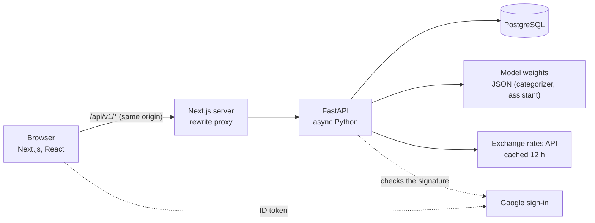

# Budget Analysis

**An expense tracker for students that knows where the allowance is going, and whether it will last the month.**

[](https://github.com/M-ALTAWEEL/budgetbuddy/actions/workflows/ci.yml)


Students get an allowance at the start of the month and find out at the end whether it was enough. Budget Analysis shows what is left at any moment, picks the category of each expense as it is typed, warns before a category runs out, and forecasts where the month is heading. It works in English, Arabic (right to left) and Turkish.

| Overview | Adding an expense | Arabic, dark |
|---|---|---|
|  |  |  |

## What it does

- **The tank.** The month's budget as a tank that empties as you spend, with a marker for today. It turns amber when the forecast says the money will not last, and red when it is gone.
- **Categories pick themselves.** Type "taxi to campus", "simit" or "فاتورة كهربا" and the category is chosen for you, by a model built from scratch (below). It also remembers your own choices: the second time you write "Aidat", it goes to your own "Building fees" category.
- **End-of-month forecast.** "At this pace you will spend about TRY 6,970 this month." Rent and other one-off payments are counted once, not projected every day.
- **Limits and alerts.** Split the budget into categories; you are warned at 85% of a limit and when you go over.
- **Tips from your own numbers.** Purchases you repeat ("Kahve, 14 times this month: TRY 840") and your most expensive day of the week.
- **This month against last month**, on the same days, so the comparison is fair.
- **Savings goals** with the amount to put aside each month to reach them on time.
- **Any currency.** Expenses in a foreign currency are converted with the day's rate; amounts can also be shown in a second currency.
- **Ask the assistant.** "How much did I spend on food last month?", "كم تبقّى؟", "Ne kadar kaldı?" Answered from your own numbers, inside the app, with no paid AI service.
- **Sign in with Google** or with email and password.
- **Three languages** with their own number formats, dates and plural rules, a full right-to-left layout for Arabic, and a dark theme.

## Machine learning, built from scratch

The models were written by hand with NumPy and plain Python, following the COE305 Machine Learning course, and checked against scikit-learn. The full work, with every result, is in two notebooks:

- [`ml/notebooks/01_expense_categorizer.ipynb`](ml/notebooks/01_expense_categorizer.ipynb)
- [`ml/notebooks/02_spending_forecast.ipynb`](ml/notebooks/02_spending_forecast.ipynb)

### Expense categorizer

| Step | What was done |
|---|---|
| Data | 1,036 labelled expense descriptions in three languages (a new app has no users yet: cold start) |
| Text | Arabic letter forms and Turkish characters normalized; words plus 3–5 letter pieces, so typos like "shawrma" still match |
| Naive Bayes | From scratch; identical to scikit-learn's to 14 decimal places. A learning curve showed the problem was too little data, so more was collected |
| Model comparison | 8 models with stratified 5-fold cross-validation. Linear models won; KNN suffered from the curse of dimensionality, decision trees overfit |
| Calibration | Naive Bayes was right only 66% of the time when it claimed 90% confidence. Logistic regression's confidence was honest, so it was chosen |
| Softmax regression | From scratch with gradient descent and L2 regularization; same probabilities as scikit-learn (largest difference 0.002). `C` and n-gram sizes chosen with `GridSearchCV` |
| Explainability | The score splits exactly into each word's share; error analysis found inconsistent labels in the data itself, which were fixed |
| In the app | Suggests a category only at ≥ 60% confidence: then it is right 81% of the time, for 40% of expenses. The student's own history comes first |

Training uses NumPy ([`ml/train_categorizer.py`](ml/train_categorizer.py)); the API reads the trained weights from JSON with plain Python ([`backend/app/ml/`](backend/app/ml/)), so the server needs no NumPy or scikit-learn and never loads a pickle.

### Assistant

A question is split into three smaller ones. **What** is asked (spent, remaining, top categories, forecast, comparison, goals) is decided by a second softmax regression, trained with the same code on 470 questions in three languages: 87.9% in 5-fold cross-validation, and at the chosen ≥ 0.4 confidence it answers 90% of questions and is right 90.7% of the time. **Which period and category** are found by small rules ("last week", "الأكل", "yemeğe"). **The number** comes from the database with the app's own calculations, so the model never makes one up; the browser writes the sentence in the student's language. Training: [`ml/train_assistant.py`](ml/train_assistant.py).

### Forecast

Linear regression with gradient descent (and feature scaling) was built and compared with a simple "same pace" baseline on 3,000 simulated months. It did no better. Error analysis showed why: rent and building fees early in the month were projected as if they happened every day. Treating days above 3× a typical day as one-off payments cut the error on day 7 from 52% to 28%, and with that feature a plain average did as well as the regression, so the simpler method shipped.

## Architecture



The backend is split by domain (`user`, `budget`, `expense`, `goal`, `currency`, `assistant`), each with its model, schema, repository, service and router.

## Engineering notes

- **Authentication.** A short-lived access token is kept in memory; the refresh token sits in an `httpOnly`, `SameSite=Lax` cookie that JavaScript cannot read, and is rotated on use. Passwords use bcrypt; login is rate limited. Google ID tokens are verified on the server: signature, audience, issuer and expiry.
- **Money.** Amounts are `Decimal`, never floats. Each expense stores the rate used to convert it, so old months never change when rates do.
- **Tests.** Over 140 backend tests run against a real PostgreSQL database, each inside a transaction that is rolled back. Google and the exchange-rate service are replaced by fakes; the Google token check is also tested with a locally generated RSA key.
- **CI.** Every push runs Ruff, pytest, ESLint, TypeScript and a production build on GitHub Actions.
- **Accessibility.** Visible keyboard focus, charts with a table of the same numbers, alerts that never rely on colour alone, and reduced motion respected.

## Tech stack

| Layer | Technology |
|---|---|
| Frontend | Next.js 16, React 19, TypeScript, Tailwind CSS 4, TanStack Query, Motion |
| Backend | Python 3.12, FastAPI, SQLAlchemy 2 (async), Alembic, Pydantic |
| Database | PostgreSQL 16 |
| Machine learning | NumPy, SciPy; scikit-learn only to check the hand-written models |
| DevOps | Docker Compose, GitHub Actions |

## Run it locally

Requires Docker Desktop and Node.js 22.

```bash
cp backend/.env.example backend/.env
docker compose up -d --build        # PostgreSQL + the API on :8000

cd frontend
npm install
npm run dev                         # http://localhost:3000
```

Sign in with Google is optional: set `GOOGLE_CLIENT_ID` in `backend/.env` (see the comment in `.env.example`). Without it the button is simply hidden.

### Tests

```bash
cd backend
python -m venv .venv
.venv\Scripts\activate              # macOS/Linux: source .venv/bin/activate
pip install -e ".[dev]"
pytest
```

### Retrain the categorizer

```bash
pip install numpy scipy pandas scikit-learn
python ml/train_categorizer.py --check
```

## Project structure

```
backend/   FastAPI app, domains, Alembic migrations, tests, app/ml (the models the API uses)
frontend/  Next.js app: pages, components, i18n (en, ar, tr), theme
ml/        datasets, training script, notebooks
docs/      architecture document and a step-by-step learning log
```

## Author

**Mouhammed Altaweel**, software engineering student · [LinkedIn](https://www.linkedin.com/in/mouhammed-altaweel) · [GitHub](https://github.com/M-ALTAWEEL)
